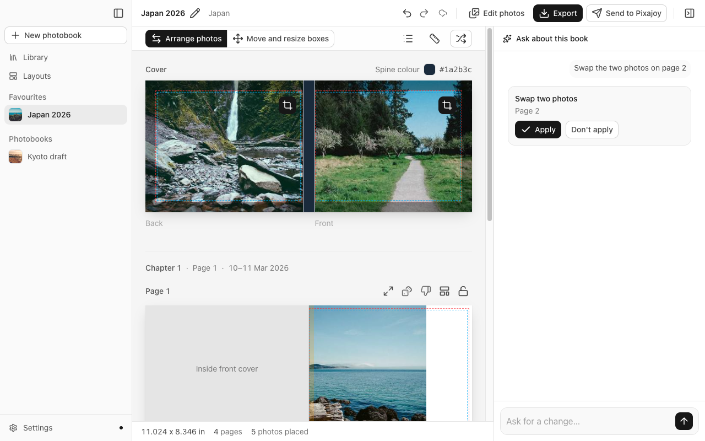
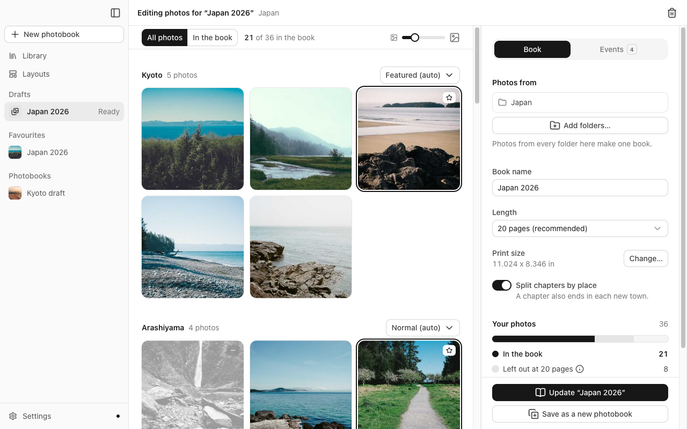
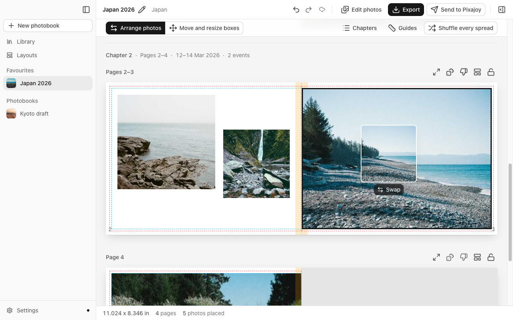
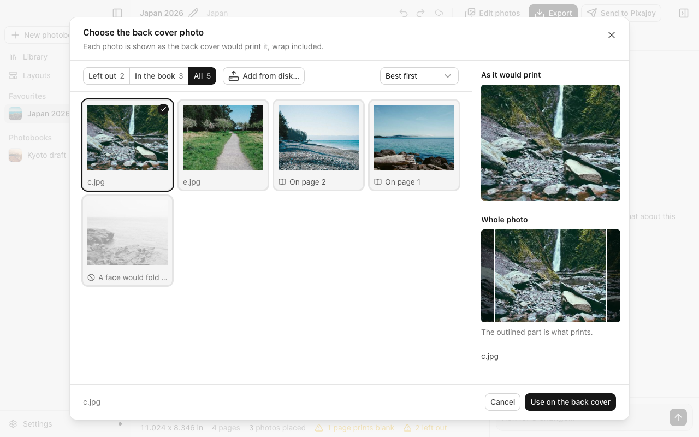
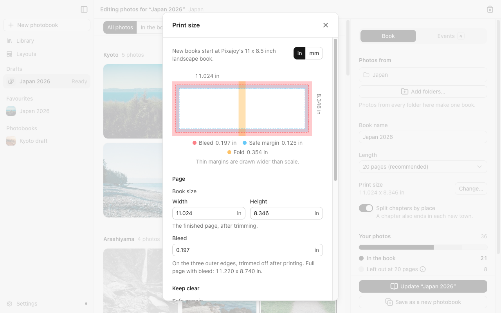
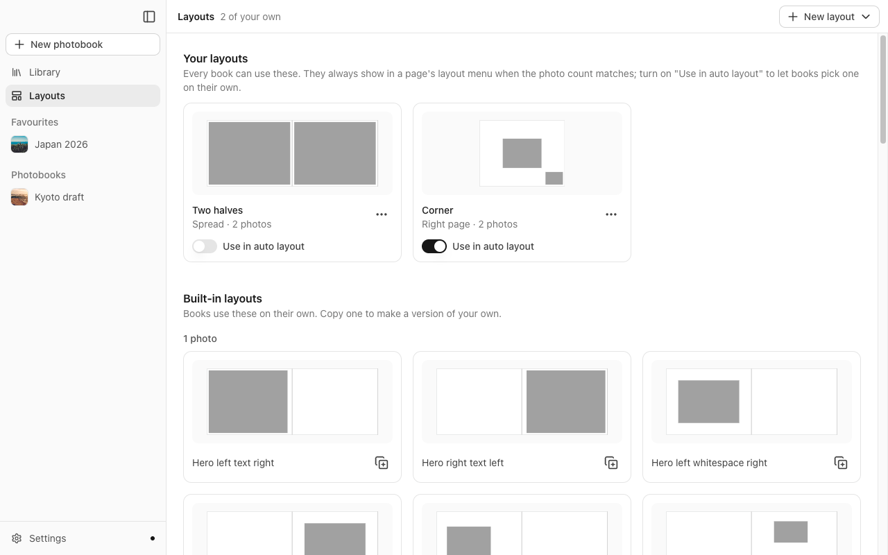
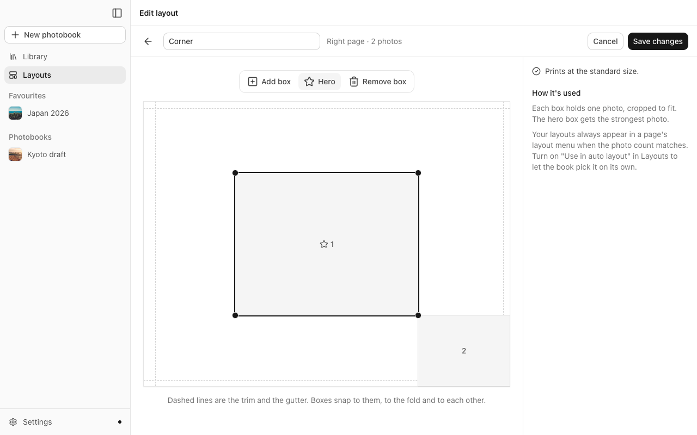
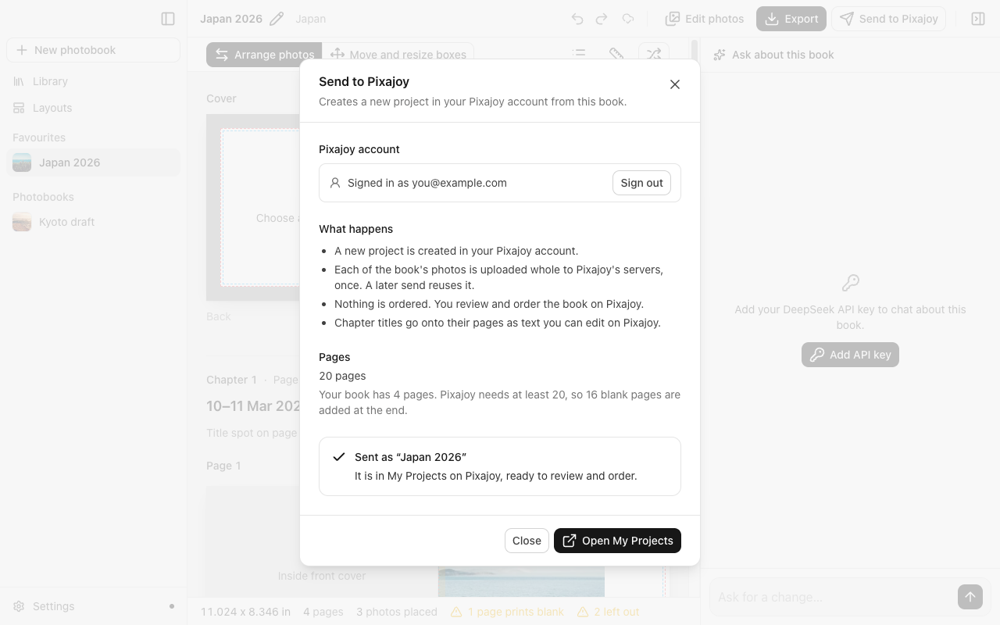
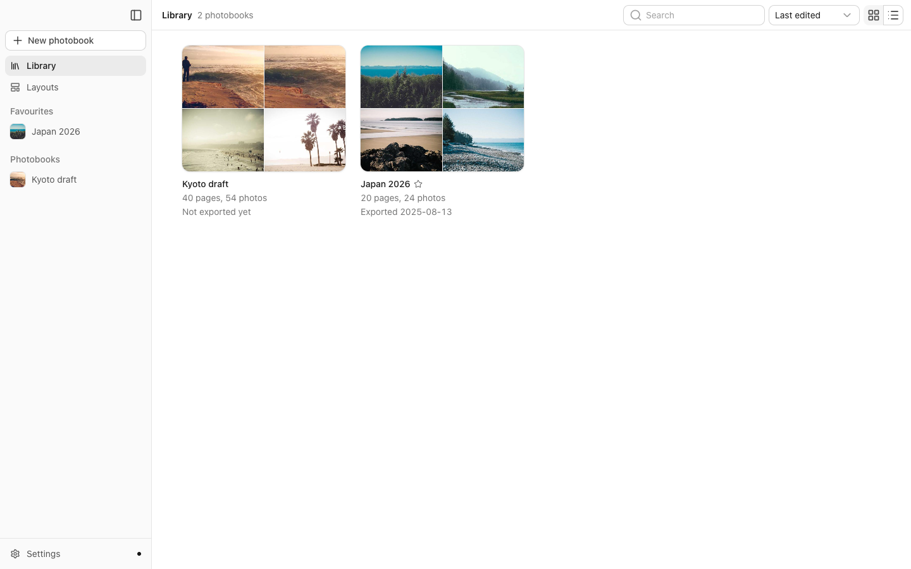

<p align="center">
  
</p>

<h1 align="center">PhotobookGen</h1>

<p align="center">
  Turn a folder of photos into a print-ready photobook, analysed entirely on your Mac.
</p>

<p align="center">
  <a href="https://github.com/Ripwords/photobook-generator/releases/download/v0.5.0/PhotobookGen_0.5.0_aarch64.dmg"></a>
  <br /><br />
  <a href="https://github.com/Ripwords/photobook-generator/releases/latest"></a>
</p>

<p align="center">
  
</p>

Pick your photo folders. PhotobookGen ranks every photo with Apple Vision, drops look-alikes
and utility shots, and lays out a book that reads like a story. Fine-tune it, then send it
straight to Pixajoy or export it for any printer.

## Point it at a folder



Every photo is analysed on your Mac for faces, sharpness, aesthetics and scene. Near-duplicates
collapse to the best frame, events get a tier, and the bar on the right shows where every
photo went. Add more folders, pick a length, and generate.

## A book that reads like a story



Chapters open on a wide shot and close on a calm one, and every page is filled with photos,
not text. Drag a photo onto another to swap them, onto another spread to move it, or onto
the cover. Edits that would cut a face or print blurry are refused with the reason.

<table>
  <tr>
    <td width="50%"></td>
    <td width="50%"></td>
  </tr>
  <tr>
    <td><b>See it before you swap it.</b> Every photo previews cropped to the slot, next to the whole frame.</td>
    <td><b>Any printer.</b> Page size, bleed, margins and DPI are set per book. Pixajoy's 11 × 8.5" is the default.</td>
  </tr>
</table>

## Make your own layouts

<table>
  <tr>
    <td width="50%"></td>
    <td width="50%"></td>
  </tr>
  <tr>
    <td>Every book can use your layouts. Switch one into auto layout and the book picks it by itself.</td>
    <td>Draw boxes that snap to the trim, fold and gutter. The panel flags anything that won't print.</td>
  </tr>
</table>

## Send it to Pixajoy



One click creates a Pixajoy project with every page, crop and cover in place,
ready to review and order. Each photo uploads once. A later send reuses it. Nothing is ever
ordered for you.

Printing somewhere else? **Export** runs a pre-flight check, then writes one cropped file per
photo plus a `manifest.json`.

## Also in the box

- **Your whole shelf.** Every book in one library, with favourites, search and drafts.
- **Front and back cover.** Picked and cropped for you, wrap included, with a spine colour
  taken from the front photo.
- **Chapters by place.** Optional. A move of more than 25 km ends a chapter, and the photo screen names it by its town.
- **Optional AI chat.** Ask for a change in plain words. Every edit waits for your approval.
  Uses your own DeepSeek key.
- **Sharper previews** when you want them, set under **Settings → General → Graphics**.

<p align="center">
  
</p>

## Install

Requires macOS 15+ on Apple Silicon. Download the dmg above and drag **PhotobookGen** to
**Applications**.

The app isn't notarized, so macOS blocks the first launch (sometimes calling it "damaged").
Right-click the app and choose **Open**, or run:

```bash
xattr -dr com.apple.quarantine /Applications/PhotobookGen.app
```

It updates itself after that.

## Privacy

**Analysis never leaves your Mac.** No photo goes anywhere until you press **Send** in
**Send to Pixajoy**. Then only the photos the book shows go, whole, to your own Pixajoy
account, and each goes once. Your Pixajoy sign-in lives in the macOS keychain. Your originals
are never modified.

The chat, if you turn it on, sends only a text description of the book (layouts, page
numbers, photo tags) to the provider you add a key for. Keys live in the macOS keychain.

Chapters by place, if you turn it on, asks Apple for a town name. It sends one point per
chapter, rounded to about a kilometre, and never a photo. With the switch off nothing is
sent. Town names stay on your Mac and are never included in what the chat sees.

## Status

Usable end to end, but not yet proven against a printed book. Sending to Pixajoy has been
tested against a live account. A second send makes a new project rather than updating
the first. Same-person grouping is blocked: Apple's on-device face data does not separate
people reliably (0.705 AUC over 555 labelled faces), and the usual alternative model is
licensed for research only. See [`docs/PROJECT-STATUS.md`](docs/PROJECT-STATUS.md) for the
full record.

## Docs

- [User manual](docs/manual.md) covers every screen, control and shortcut.
- [Development](docs/development.md) covers building, testing, benchmarks and releases.

```bash
bun install && bun run dev
```
